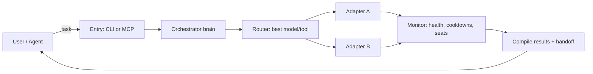

# air

**Status:** Release candidate. 211 tests passing (parallel isolated workers). CLI + MCP server functional. Build, lint and package dry-run green on CI. All review tasks complete.

Unified AI tool orchestrator with smart routing and failover. One CLI + MCP server to route tasks across aider and goose with automatic failover on rate limits.

## VS Code setup

Add AIR as an MCP server in your VS Code settings so agents can call it:

```json
{
  "mcp": {
    "servers": {
      "air": {
        "command": "air",
        "args": ["mcp"]
      }
    }
  }
}
```

Then run `air status` in the integrated terminal to see available models, cooldowns, and task history. The orchestrator persists sessions under the cache dir, so work survives restarts.

Work enters through the CLI or MCP, is routed to the best available adapter, executed in isolated sessions, monitored, and compiled into one response.



- **Entry**: `air run` or MCP `run_task`
- **Orchestration**: central orchestrator selects adapters and manages sessions
- **Distribution**: multiple sessions run in parallel when safe
- **Monitoring**: health, cooldowns, concurrency seats, process trees
- **Compilation**: results, deltas, and handoff are merged into one response

- **Routing** - Priority-list candidate selection with exact skip reasons (cooldown_active, capability_mismatch, cannot_handle, tool_not_registered)
- **Failover with control** - Asks before switching by default, optional auto-switch (`--auto`)
- **Stream + buffer** - Live output while parsing for rate limits; bounded rolling buffer with truncation metadata
- **Context handoff** - Builds handoff from git state (never model summary); redacts secrets
- **MCP server** - Expose routing to other agents via stdio JSON-RPC. `run_task` runs jobs in the background; `get_task_status`, `get_task_output`, `approve_failover`, `cancel_task` and `get_status` poll and drive the same run.
- **Safety** - Dirty-tree refusal by default (`--allow-dirty` opt-in); provider allow-list; hop cap; revisit prevention
- **Success detection** - Uses actual workspace delta (git status/diff), not stdout length
- **Process facts** - Timeout, cancellation, and spawn errors take precedence over stderr matching
- **Streaming redaction** - Secrets redacted per-chunk with overlap to catch split tokens
- **Model catalog** - Lists every adapter's provider/model, capabilities, cost tier, and context window; `air models --best <task>` recommends the cheapest eligible model
- **Multi-session parallel** - Runs multiple tasks concurrently, each on its own model, with independent job state and concurrency seats
- **Inter-process coordination** - Lock files with stale-lock recovery; health flush and task-index append are concurrency-safe

## Known limitations

- All adapters verified where binaries are installed; unverified spikes removed.
- Verified adapters (aider, goose) require the external CLI to be installed and on PATH; their command syntax and permission flags were smoke-tested locally.

## Quick Start

```bash
npm ci
npm run dev -- --help
```

For a global CLI on your shell PATH:

```bash
npm run build
npm link
```

## Commands

- `air run "<task>"` - Route and run task (`-f, --files`, `--auto`, `--allow-dirty`, `--read-only`)
- `air status` / `air health` - Show tools, providers, models, and active cooldowns (health is a true alias; `--json`)
- `air route-test "<task>" --explain` - Test routing without executing (`--json`)
- `air config --validate` - Validate config against the Zod schema
- `air config migrate` - Upgrade config to the current schema version
- `air verify -- <cmd...>` - Run an approved verification command (array args, no shell)
- `air dashboard` - Show orchestrator sessions, decisions, and events (side-panel style)

## Exit codes

| Code | Name | Meaning |
|---|---|---|
| 0 | SUCCESS | Succeeded with changes or read-only |
| 1 | NO_CHANGES | Write task exited 0 with empty diff |
| 2 | ALL_EXHAUSTED | Hop cap reached, no eligible candidate, or allow-list blocked |
| 3 | USER_CANCELLED | Cancelled |
| 4 | CONFIG_OR_DIRTY | Config invalid, dirty-tree refused, or verify failed |
| 5 | TIMEOUT | Timed out |
| 6 | TASK_FAILURE | Failed; tool exited non-zero with no failover category |

## Configuration

Configuration lives in a platform-appropriate directory, resolved by a single
central path module:

| Platform | Config | Cache/State |
|---|---|---|
| Linux | `$XDG_CONFIG_HOME/air` (fallback `~/.config/air`) | `$XDG_CACHE_HOME/air` (fallback `~/.cache/air`) |
| macOS | `~/Library/Application Support/air` | `~/Library/Caches/air` |
| Windows | `%APPDATA%/air` | `%LOCALAPPDATA%/air` |

Global config: platform config directory / `config.yaml`  
Repo config: `.airrc.yaml` (untrusted by default; validation required)  
Cache: platform cache directory / `air/`

Precedence: CLI > env > repo `.airrc.yaml` > global > defaults.

## Development

```bash
npm run typecheck      # app typecheck
npm run typecheck:test # test typecheck
npm test               # vitest
npm run build          # tsc
npm run lint           # eslint
npm run dev            # tsx bin/air.ts
```

## Adapters

### Verified

| Adapter | Executable | Headless | Verified |
|---|---|---|---|
| aider | `aider` | `--message`, `--yes-always`, `--exit` | 0.86.2 |
| goose | `goose` | `goose run --text` | 1.57.0 |

### Unverified (visible, never routed)

| Adapter | Executable | Headless | Verified |
|---|---|---|---|
| opencode | `opencode` | `run --prompt --yes` | VERIFIED |
| kilocode | `kilocode` | `run --prompt --yes` | VERIFIED |
| codex | `codex` | `exec --skip-git-repo-check` | VERIFIED |
| github-copilot | `gh` | `copilot --allow` | VERIFIED |
| mock (test-only) | `node tests/fixtures/mock-tool.js` | env-controlled | n/a |

Adapters are discovered from PATH at runtime. The mock adapter is test-only and is never registered by production code.