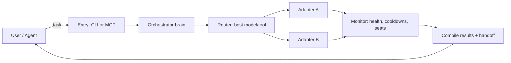

# air — Unified AI Tool Orchestrator

*AIR is free and so are we.*

**Status:** Release candidate. 234 tests passing (parallel isolated workers). CLI + MCP server functional. Build, lint and package dry-run green. All review tasks complete.

AIR is a single terminal entrypoint and MCP server that routes tasks across AI coding tools (aider, goose, opencode, kilocode, codex, github-copilot) with automatic failover on rate limits, preserving context so work continues seamlessly. It presents one conversational agent to the user while every other model/tool acts as an internal worker.

## Purpose and benefit

- **One agent feel:** You talk to AIR. It owns the conversation, plan, execution, monitoring and evidence; background tools are interchangeable hands, not the face of AIR.
- **Free-first by policy:** Local and verified free models are preferred; paid fallback requires explicit consent; unknown cost is never treated as free.
- **Non-blocking:** Submit work, keep talking. Follow-ups arrive while jobs run; results are compiled into one coherent reply.
- **Safe:** Dirty-tree refusal by default, provider allow-list, hop cap, revisit prevention, redaction of secrets in all output/logs/handoffs.
- **Evidence over claims:** Success is computed from the actual workspace delta (`git status`/`git diff`) and verification output, never from a model saying "done".
- **Cross-platform:** Windows, macOS, Linux. Self-contained: all config, model lists and data live inside `air/`.

## Architecture



Components:
- **CLI (`air`)** — `bin/air.ts` with commands: run, status/health, route-test, config, mcp, adapters, chat, resume, verify, dashboard, commands, models.
- **Config** — Zod schema is single source of truth, versioned (`version: 1`); `air config migrate` upgrades. Platform-appropriate global config + optional repo `.airrc.yaml` (untrusted). Precedence: CLI > env > repo > global > defaults.
- **Router** — Priority list with free-first cost sorting, cooldowns keyed by (provider, model), exact skip reasons.
- **Adapters** — Per-tool connectors implementing `AgentAdapter` (id, provider, model, capabilities, canHandle, buildCommand, parseOutput, classifyError). Conformance suite gates registration. Test-only mock adapter under `src/adapters/mock.ts`.
- **Context packer / handoff** — Builds handoff from git state only (never model prose), redacts secrets.
- **Health tracker** — Keyed by (provider, model), persisted atomically with cooldowns and free-tier usage.
- **MCP server** — Async jobs, stdio, no prompting on stdio; approval is a task-state transition.
- **Execution** — Shared process runner with cross-spawn, timeouts, tree kill, code-point-safe byte caps, streaming redaction.
- **Security** — Redaction choke point (`src/security/redact.ts`), provider allow-list, verify trust gate, global-only config keys.
- **Observability** — Structured JSONL traces; `air status --json`; `air route-test --explain`; `air dashboard`.
- **Concurrency** — Per-config-dir lock/semaphore; `maxConcurrentAgents` (default 1); atomic health/cooldown writes; real git worktrees for write jobs.
- **Conversation** — Persistent `ConversationSession` store (`src/conversation/`) with neutral message format; `air chat` REPL; MCP `chat_send`/`get_conversation`.
- **Planner / result compiler** — Lightweight task decomposition and coherent reply compilation (`src/planner`, `src/result-compiler`).
- **Permissions** — Shared permission policy (`src/permissions`) applied before worker invocation.
- **Workspace** — Real git worktree isolation per write job (`src/workspace`).

## Quick start

```bash
npm ci
npm run dev -- --help
```

For a global CLI on your shell PATH:

```bash
npm run build
npm link
```

## Commands

- `air run "<task>"` - Route and run task (`-f, --files`, `--auto`, `--allow-dirty`, `--read-only`, `--allow-provider`)
- `air resume <runId> [task]` - Resume a previous session with handoff context
- `air status` / `air health` - Show tools, providers, models, cooldowns, install status (`--json`)
- `air adapters list|install|upgrade|uninstall|status` - Manage free AI adapters from the catalog
- `air route-test "<task>" --explain` - Test routing without executing (`--json`)
- `air config --validate` / `air config migrate` - Validate/migrate config
- `air verify -- <cmd...>` - Run an approved verification command (array args, no shell)
- `air dashboard` - Show orchestrator sessions, decisions, events, connected adapters
- `air commands` - List available commands
- `air models` - List adapters with provider/model and allow-list status
- `air chat` - Interactive non-blocking conversation (`--resume <id>`, `--free-only`, `--allow-paid`)
- `air mcp` - Start MCP server over stdio
- `--dev` - Developer mode with verbose diagnostics

## Exit codes

| Code | Name | Meaning |
|---|---|---|
| 0 | SUCCESS | Succeeded with changes or read-only |
| 1 | NO_CHANGES | Write task exited 0 with empty diff |
| 2 | ALL_EXHAUSTED | Hop cap reached, no eligible candidate, or allow-list blocked |
| 3 | USER_CANCELLED | Cancelled |
| 4 | CONFIG_OR_DIRTY | Config invalid, dirty-tree refused, or verify failed |
| 5 | TIMEOUT | Timed out |
| 6 | TASK_FAILURE | Failed; tool exited non-zero with no failover category |

## Configuration

Configuration lives in a platform-appropriate directory, resolved by a single central path module:

| Platform | Config | Cache/State |
|---|---|---|
| Linux | `$XDG_CONFIG_HOME/air` (fallback `~/.config/air`) | `$XDG_CACHE_HOME/air` (fallback `~/.cache/air`) |
| macOS | `~/Library/Application Support/air` | `~/Library/Caches/air` |
| Windows | `%APPDATA%/air` | `%LOCALAPPDATA%/air` |

Global config: platform config directory / `config.yaml`
Repo config: `.airrc.yaml` (untrusted by default; validation required)
Cache: platform cache directory / `air/`

Precedence: CLI > env > repo `.airrc.yaml` > global > defaults.
Repo config cannot set global-only keys (failover, permission, redaction, trustedRepos, tools, concurrency, verify, catalog, timeouts, buffers, logging).

## Adapters

### Verified (CI-smoke-tested and eligible for routing)

| Adapter | Executable | Headless | Verified | Version |
|---|---|---|---|---|
| aider | `aider` | `--message`, `--yes-always`, `--exit` | yes | 0.86.2 |
| goose | `goose` | `goose run --text` | yes | 1.57.0 |

### Unverified spikes (visible in `air status`, never routed)

| Adapter | Executable | Version (claimed) |
|---|---|---|
| opencode | `opencode` | 2.2.5 |
| kilocode | `kilocode` | 7.5.16 |
| codex | `codex` | 0.166.0 |
| github-copilot | `gh` | 2.102.0 |

Adapters are discovered from PATH at runtime. The mock adapter is test-only and is never registered by production code. Unverified adapters require confirmation of headless flags before they become eligible.

## Free AI Adapter Catalog

AIR bundles a catalog of free AI tools installable in the background through `air adapters install <id>`. Catalog lives in `config/catalog.json` and can be overridden via `catalog.remoteUrl` (HTTPS only, metadata-only merge). Install status persisted in cache dir and shown in `air status` and `air adapters list`.

## Development

```bash
npm run typecheck      # app typecheck
npm run typecheck:test # test typecheck
npm test               # vitest
npm run build          # tsc
npm run lint           # eslint
npm run dev            # tsx bin/air.ts
```

## Known limitations

- Only aider and goose are CI-smoke-test verified and eligible for routing.
- Verified adapters require the external CLI installed and on PATH.
- Cross-provider front-agent fallback is not implemented in MVP (same-provider fallback only).
- Daemon/IPC mode is not yet implemented; state is file-based with atomic writes and crash recovery.
- Web UI not included; CLI + MCP only.
