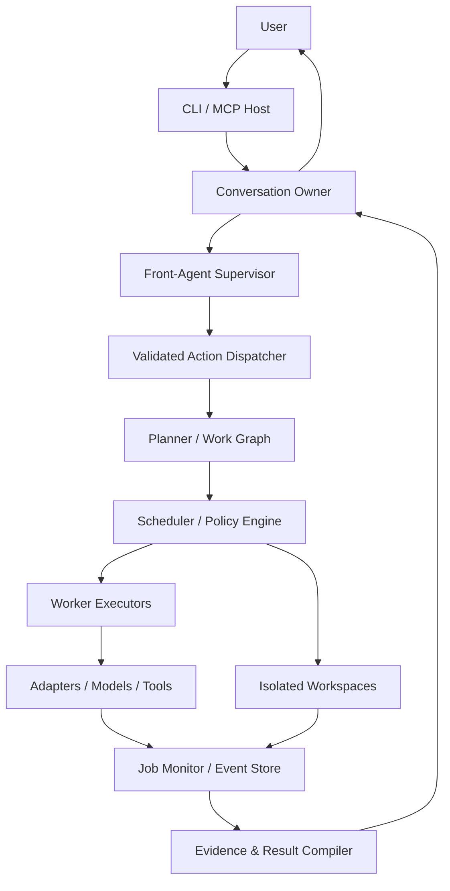

# AIR — Deep Product & Architecture Review + Next Implementation Plan

**Review date:** 4 November 2026  
**Repository:** [`radmanmilos/air`](https://github.com/radmanmilos/air)  
**Branch:** `main`  
**Reviewed HEAD:** [`e19aeadb4edfd8f43efa3dd266e0746cb0b3e5f3`](https://github.com/radmanmilos/air/commit/e19aeadb4edfd8f43efa3dd266e0746cb0b3e5f3)  
**Previous review baseline:** [`947428fa8067250f9b7b540e99a6517c1ffb4327`](https://github.com/radmanmilos/air/commit/947428fa8067250f9b7b540e99a6517c1ffb4327)  
**Change since previous review:** 32 commits ahead, 0 behind  
**Latest verified CI run:** [CI run 114](https://github.com/radmanmilos/air/actions/runs/41822278977) — completed successfully on the reviewed HEAD.

---

## 1. Executive verdict

<blockquote>
**AIR has made real engineering progress, but it is not yet the product described by the vision.** The repository now contains much more of the intended architecture: a persistent conversation data model, a basic planner, a result compiler, permission helpers, a Git worktree helper, capability-aware routing, concurrency seats, and stronger persistence/security code. The critical issue is that most of these new modules are isolated building blocks rather than components participating in a single runtime lifecycle.
</blockquote>

The current product still behaves primarily like a command-line wrapper around AI coding tools. It does not yet reliably behave like one persistent super-agent that owns the user's intent, decomposes work, delegates to multiple workers, monitors them, accepts meaningful follow-up instructions while work is active, and delivers one verified response.

### Honest progress estimate

These percentages are judgement calls about product capability, not code coverage or completion metrics.

| Dimension | Estimated progress toward the intended product | Why |
|---|---:|---|
| Tool adapters and basic process execution | 60–65% | Several adapters exist; only Aider and Goose are eligible for normal routing. |
| Basic routing and failover | 35–45% | Candidate filtering, cooldowns, and failover paths exist, but current authorization and MCP lifecycle defects remain. |
| Reliable multi-worker coordination | 15–20% | Concurrency seats exist, but no production planner-to-scheduler-to-worker DAG is connected. |
| Persistent conversation storage | 40–50% | A useful provider-neutral store exists; it is not yet the live owner of execution or context. |
| Front-agent / supervisor intelligence | 5–10% | Action schema exists, but no front-agent loop interprets messages and invokes actions. |
| Follow-ups that alter active work | 5–10% | Messages can be stored and acknowledged; they are not incorporated into a running plan. |
| Live monitoring and recovery | 15–20% | Some state is persisted, but there is no reliable event stream, worker reattachment, or complete job-control path. |
| Permissions and workspace isolation | 10–15% | Helper modules exist, but the active orchestrator does not use them. |
| Unified result synthesis | 5–10% | A small formatter exists; it is not called and does not synthesize multiple worker results. |
| Free-first / no-surprise-cost policy | 15–20% | Some metadata and preferences exist, but the router does not enforce them as runtime policy. |

**Overall:** approximately **25–30% of the way to the stated goal**. This is higher than the previous 20–25% estimate because the repository now has more of the intended structure and some foundational fixes. It is not dramatically higher because the end-to-end user experience has not changed enough: the supervisor, job graph, monitoring loop, and follow-up control path are still missing or disconnected.

### Release recommendation

**Do not call this a release candidate for the promised super-agent experience yet.** The latest CI is green, which is positive, but the most important acceptance scenario—submit a compound task, continue the conversation while workers run, change the plan with a follow-up, and receive one verified result—does not exist as a completed runtime path.

The next milestone should not be more adapters, command flags, or README architecture diagrams. It should be one working, tested vertical slice of the product.

---

## 2. What changed since the previous review

The previous review was against commit `947428f`. Current `main` is 32 commits ahead. The most relevant additions include:

| Change | Evidence | Assessment |
|---|---|---|
| Persistent conversation store | [`src/conversation/index.ts`](https://github.com/radmanmilos/air/blob/e19aead/src/conversation/index.ts) | Useful durable message model and atomic append path. Not connected to worker/job orchestration. |
| Action schema | [`src/conversation/actions.ts`](https://github.com/radmanmilos/air/blob/e19aead/src/conversation/actions.ts) | Clear start for `answer`, `spawn_job`, `cancel_job`, `status`, `clarify`. No active front-agent consumes it. |
| Planner | [`src/planner/index.ts`](https://github.com/radmanmilos/air/blob/e19aead/src/planner/index.ts) | Basic regex-based task classification; not an execution graph planner and not called by runtime. |
| Result compiler | [`src/result-compiler/index.ts`](https://github.com/radmanmilos/air/blob/e19aead/src/result-compiler/index.ts) | Small factual response formatter; not called by runtime and not a multi-worker synthesis engine. |
| Shared permission helper | [`src/permissions/index.ts`](https://github.com/radmanmilos/air/blob/e19aead/src/permissions/index.ts) | Not wired into orchestration; its modes do not match the current config schema. |
| Git worktree helper | [`src/workspace/index.ts`](https://github.com/radmanmilos/air/blob/e19aead/src/workspace/index.ts) | Creates/removes real worktrees in isolation tests; not called by the active orchestrator. |
| Capability-aware task fields and routing | [`src/types/index.ts`](https://github.com/radmanmilos/air/blob/e19aead/src/types/index.ts), [`src/router/router.ts`](https://github.com/radmanmilos/air/blob/e19aead/src/router/router.ts) | Better task metadata and filtering; still coarse, priority-list/fuzzy cost based rather than a robust policy scheduler. |
| Cross-process concurrency seats | [`src/utils/concurrency.ts`](https://github.com/radmanmilos/air/blob/e19aead/src/utils/concurrency.ts), [`src/orchestrator/orchestrator.ts`](https://github.com/radmanmilos/air/blob/e19aead/src/orchestrator/orchestrator.ts) | A seat is now acquired around a worker process. Does not itself implement work-graph concurrency or resource governance. |
| Atomic orchestrator snapshot and crash handling | [`src/orchestrator/orchestrator.ts`](https://github.com/radmanmilos/air/blob/e19aead/src/orchestrator/orchestrator.ts) | Better than the prior direct write, but concurrent instances can still overwrite one another; recovery marks every persisted RUNNING session failed without checking whether a worker remains alive. |
| Stronger lock ownership and UTF-8-safe process output caps | [`src/utils/lock.ts`](https://github.com/radmanmilos/air/blob/e19aead/src/utils/lock.ts), [`src/execution/runner.ts`](https://github.com/radmanmilos/air/blob/e19aead/src/execution/runner.ts) | Genuine hardening. The seat stale-reclaim path still has a race to address. |
| Config trust boundary | [`src/config/loader.ts`](https://github.com/radmanmilos/air/blob/e19aead/src/config/loader.ts), [`src/adapters/registry.ts`](https://github.com/radmanmilos/air/blob/e19aead/src/adapters/registry.ts), [`src/config/catalog.ts`](https://github.com/radmanmilos/air/blob/e19aead/src/config/catalog.ts) | Material improvement: repo config cannot set global-only keys; dynamic adapter module imports are disabled; remote catalog updates are metadata-only for bundled tools. |
| CLI chat and MCP conversation tools | [`bin/air.ts`](https://github.com/radmanmilos/air/blob/e19aead/bin/air.ts), [`src/mcp/server.ts`](https://github.com/radmanmilos/air/blob/e19aead/src/mcp/server.ts) | Entry points exist, but their current behavior is acknowledgement/storage, not a supervisor experience. |

### Prior findings: status update

| Previous finding | Current status | Notes |
|---|---|---|
| Repo config could activate arbitrary dynamic adapter imports | **Resolved in current code path** | Dynamic factory loading is removed/no-op; repo config cannot set `catalog`. Keep the static registry model unless a separately trusted extension system is designed. |
| Repo config could self-authorize repo verification | **Resolved in current config path** | `trustedRepos` is global-only and stripped from repo config. Keep a test that proves a malicious `.airrc.yaml` cannot add itself. |
| Orchestrator and MCP generated different run IDs | **Still open** | `run_task` creates an outer ID; `Orchestrator.start()` creates another ID. MCP stores the job by the outer ID but the session/state is created with the inner ID. |
| MCP cancellation did not reach the worker | **Still open** | MCP aborts `job.controller`; `Orchestrator.start()` creates and passes its own private controller. The MCP controller is never passed into the run. |
| MCP stdout could be corrupted by worker output | **Still open** | Orchestrator still pipes worker output to `process.stdout` even in `mcpMode`. |
| Failover authorization / cross-provider path | **Still open / partly changed** | Allow-list remains applied after candidate search; model allow-list is pinned to the first model. MCP consent fields are checked against the wrong proposal shape and no proposal hash is created. |
| Orchestrator-wide concurrency seat | **Improved** | `start()` now takes a seat around `runProcess`; `handles` are still not populated, so cancellation/wait APIs remain disconnected. |
| Workspace isolation was only a flag | **Helper added, integration still open** | Real worktree helper exists but the active runner still uses the original project `cwd`. |
| Conversation did not persist | **Storage layer added, product flow still open** | Conversation file store is present; chat/MCP do not perform actual front-agent reasoning or job linkage. |
| Planner / result compiler missing | **Skeleton modules added, integration still open** | Code search shows the new functions referenced only in their module/tests/docs. |
| Permissions were not enforced | **Still open; new helper is not usable yet** | The helper is unused and its `PermissionMode` conflicts with the config schema. |
| Multi-process persistence was not safe | **Partly improved** | Atomic rename helps prevent partial files; no shared transaction/lock around orchestrator snapshot read-modify-write. |
| Free-first was not an enforced policy | **Still open** | Router still infers a rough cost tier from provider/model strings; conversation preference is not propagated into runtime routing. |
| UTF-8 byte cap could split a character | **Improved** | Runner now backs off from continuation bytes at cap/tail boundaries. |
| Adapter verification claims not reflected in routing/CI | **Partly improved / still needs evidence** | Only Aider and Goose are marked verified and routed; other four are correctly unverified. CI smoke is limited and should be described accurately. |

---

## 3. CI and evidence review

### Latest CI result

The latest commit has a successful GitHub Actions run:

- Workflow: `CI`
- Run: [#114](https://github.com/radmanmilos/air/actions/runs/41822278977)
- Commit: `e19aeadb4edfd8f43efa3dd266e0746cb0b3e5f3`
- Conclusion: `success`
- Jobs: Ubuntu 24.04 / Node 22, Windows latest / Node 22, and a Linux real-binary smoke job.
- Standard jobs report success for app typecheck, test typecheck, test suite, build, lint, package dry-run, pack, and package smoke test.

This is good evidence that the current branch builds, lints, packages, and passes the repository's automated tests on the two tested operating systems with Node 22.

### What the green CI does not prove

The real-binary smoke workflow installs Aider and attempts to install Goose on a best-effort basis. The test file is gated by `AIR_SMOKE_TEST=1`. In the current smoke suite:

- Aider runs a small read-style command against a temporary workspace.
- Goose checks `--version`; it does not perform an actual work task.
- OpenCode, KiloCode, and Codex tests only check a version response if those binaries happen to be present.
- There is no GitHub Copilot real-binary smoke test.
- CI runs Node 22 only, despite `package.json` declaring Node `>=18.0.0`.

Therefore, the correct claim is **“CI passes on Node 22 for Ubuntu and Windows; Aider has a limited task smoke test; other adapter compatibility remains partially or unverified.”** Do not claim all six adapters were exercised by CI.

### Test coverage quality

The new tests prove individual helper behavior, but do not prove the product workflow:

- Conversation tests create/load/append messages serially. They do not start work, follow up, recover an active conversation, or check multiple concurrent writers.
- Planner tests cover a simple edit and a review request. They do not test a multi-step plan, dependency scheduling, replanning, or malformed planner output.
- Compiler tests cover a simple success and failure string. They do not merge multiple workers or validate acceptance criteria.
- Permission tests check helper return values only. They do not assert that any real adapter invocation is blocked or constrained.
- Workspace tests create and remove a worktree. They do not prove that an actual worker is launched in it, that source files remain untouched, or that a result can be safely reviewed/applied.
- MCP lifecycle tests still use in-memory transport for important coverage; they do not replace a child-process test of actual stdio JSON-RPC framing, worker cancellation, and approval.

**Testing direction:** shift from “does each helper function work?” to “does the user journey remain correct under failure, concurrency, process interruption, and follow-up input?”

---

## 4. Critical findings in the current code

The following issues are based on the reviewed source at `e19aead`, not on task-list completion labels. Severity reflects impact on the stated product and user safety.

### P0 — Must fix before claiming a safe, working super-agent

#### R6-01 — One canonical job ID is still not shared between MCP and Orchestrator

**Evidence:** `src/mcp/server.ts` creates `runId = makeRunId()` inside `run_task`, keys `jobs` by that ID, and returns it to the caller. `runTaskInBackground()` then calls `orch.start(...)`. `Orchestrator.start()` creates its own separate `runId = makeRunId()` and persists its task/session under that second ID.

**Impact:** MCP's external job ID is not necessarily the ID known by the orchestrator or task-state store. `approve_failover` calls `resumeAfterApproval(args.runId)` using the outer ID; `Orchestrator` has the inner ID. Resume and approval can fail or status can show mismatched identifiers.

**Required change:** generate the ID exactly once at the boundary and pass it into `Orchestrator.start({ runId })`, or have the orchestrator synchronously allocate/return a job handle before execution starts. Use the same canonical identifier in job map, orchestrator, task-state, event store, conversation link, and MCP response.

**Acceptance tests:** assert returned ID = orchestrator session ID = task-state ID = event run ID; approve/resume/status/cancel all use this one ID.

#### R6-02 — MCP cancellation still does not cancel the actual process

**Evidence:** MCP `Job` has an `AbortController`; `cancel_task` aborts `job.controller` and manually writes `CANCELLED`. However, `runTaskInBackground()` does not pass that signal into `Orchestrator.start()`. The orchestrator creates a new controller and passes that private controller to `runProcess()`.

**Impact:** the MCP caller can be told a job is cancelled while the worker is still executing and modifying files. A false cancellation is a correctness and safety problem.

**Required change:** introduce one lifecycle-owned cancellation token / controller shared by the job manager, orchestrator, and process runner. Do not mark CANCELLED until the worker process tree has exited and the seat has been released. Persist the final process outcome, not a caller-side optimistic state mutation.

**Acceptance tests:** launch a mock child that writes its PID and loops; cancel over actual MCP stdio; prove the process and descendants exit, state becomes CANCELLED after close, and concurrency seat is released. A test that only changes an in-memory state is insufficient.

#### R6-03 — MCP worker output still writes to stdout and can corrupt JSON-RPC

**Evidence:** `Orchestrator.start()` and `resumeAfterApproval()` configure `runProcess` callbacks that call `process.stdout.write()` / `process.stderr.write()`. The MCP server uses `StdioServerTransport`, which owns stdout for JSON-RPC frames.

**Impact:** arbitrary tool output can be interleaved with protocol messages, causing MCP clients to lose framing or disconnect. This was a known earlier issue and remains in the active orchestration path.

**Required change:** make output delivery a dependency of the execution runtime. CLI mode may stream to terminal; MCP mode must capture/persist output and expose it through an output/event tool or MCP notifications. stdout must be protocol-only while stdio transport is active. Route diagnostics to stderr/logs.

**Acceptance tests:** spawn the built `air mcp` process, submit a job whose mock worker emits noisy stdout/stderr, parse every stdout frame as valid MCP JSON-RPC, and assert worker text appears only in the appropriate result/output API.

#### R6-04 — The new permission module is not enforced and does not match the config schema

**Evidence:** `src/permissions/index.ts` exports `fromConfig()` and `enforce()`, but code search finds no runtime call sites outside the module and its tests. It defines modes `read_only | edit | edit_and_shell`. `src/config/schema.ts` defines permission modes `ask | auto | deny`. The helper treats `ask` and `auto` as `read_only`; the schema has no `allowNetwork`, `allowInstall`, or `allowedPaths` fields that the helper expects.

**Impact:** the README says permissions are applied before worker invocation, but the actual worker path still launches adapters with their own broad tool permissions. For example, Aider uses `--yes-always`; Goose advertises shell access; other adapters have broad auto/tool flags. AIR cannot reliably state what a worker is permitted to do, and the current helper cannot map the actual config.

**Required change:** define one permission model with explicit semantics (read-only, edit-only, edit+shell, network, install, allowed paths, commit, push, external data egress). Reconcile it with config schema and CLI/MCP approval. Evaluate the policy immediately before every invocation, then translate to the narrowest adapter-specific flags. If an adapter cannot honor the requested restriction, refuse that execution rather than silently running broader.

**Acceptance tests:** use instrumented mock adapters to attempt writes, shell, network, install, commit, and path traversal under every policy mode. Assert denied operations never reach the child process. Include provider/adapter conformance checks for every routed adapter.

#### R6-05 — Provider failover consent is still inconsistent and the proposal is not cryptographically bound

**Evidence:** Orchestrator pins `allow.models = [chosen.model]` on the first hop. It discovers the next candidate with `allow = null`, then performs a later `checkHandoffAllowlist()`. That model allow-list can block legitimate model changes. Separately, MCP `approve_failover` compares `args.provider` to `proposal.provider` and `args.model` to `proposal.model`, while the orchestrator proposal stores those values under `proposal.to.provider` and `proposal.to.model`. The proposal object shown in `Orchestrator.start()` does not create a `hash`, yet MCP only verifies a supplied hash when one exists.

**Impact:** valid failovers can be blocked; consent validation may compare against undefined properties; optional consent fields can be accepted without proof that the exact task/data/destination proposal was reviewed.

**Required change:** separate candidate eligibility from authorization. Build an immutable proposal object with exact source/destination adapter/provider/model, data classification, context payload digest, cost class, reason, and one-time nonce/hash. Verify approval against `proposal.to.*` and require the proposal digest for cross-provider or paid egress. Ensure `allowProviderSwitch` config and CLI/MCP arguments have one documented meaning.

**Acceptance tests:** provider A rate-limit -> provider B proposal -> approve exact proposal succeeds; altered provider/model/hash fails; decline prevents execution; same-provider model change follows policy; free-only never proposes a paid destination.

### P1 — Must fix to deliver the intended experience

#### R6-06 — There is still no live front-agent / supervisor loop

**Evidence:** `ActionSchema` exists with `answer`, `spawn_job`, `cancel_job`, `status`, and `clarify`, but no runtime front agent parses a model response and executes these actions. Search for `parseActions` / schema call sites should be included in the next review's regression check. The user-facing entry points do not invoke a supervisor model.

`air chat` in `bin/air.ts` creates/loads a conversation and stores messages. A normal message receives the fixed assistant text `Acknowledged.`. `/run` invokes `orch.start()` directly and appends a started-job message after the call returns. MCP `chat_send` similarly appends the user's message and a fixed `Acknowledged.` assistant message and returns the conversation ID. It does not spawn work or return a front-agent answer.

**Impact:** the user is still not interacting with AIR as an intelligent persistent agent. The conversation store is a transcript container, not the owner of user intent or decision-making.

**Required change:** choose and document one front-agent ownership model:

1. **Host-owned supervisor (recommended for the MCP path):** the connected host agent remains the one user-facing intelligence. AIR provides a stable conversation/job API, context and state retrieval, action tools, follow-up instructions, approval, and result delivery. AIR must not pretend an acknowledgement is a meaningful answer.
2. **AIR-owned supervisor (needed for standalone `air chat`):** AIR calls a configured front-agent model using a neutral conversation format, validates an action response, executes actions through the job manager, and returns natural-language answers while keeping workers hidden.

Both modes should use the same durable conversation and job contracts. Do not duplicate supervisor state between a host model and an AIR model in the same interaction.

#### R6-07 — Planner is a heuristic classifier, not a work-graph planner, and is not invoked

**Evidence:** `planFromRequest()` uses regexes to classify a prompt and produce one or occasionally two `WorkItem`s. It is referenced only by its module and unit tests. The Orchestrator continues to select a candidate and run the original prompt directly.

**Impact:** compound tasks are not decomposed into inspection, implementation, test, review, and verification work. There is no DAG scheduler, dependencies, replanning, or result aggregation.

**Required change:** implement a typed `WorkGraph` with work-item state, objective, acceptance criteria, required capabilities, dependencies, permissions, workspace, budget/cost constraints, and execution result schema. Planner output must be validated. Initially keep decomposition conservative and human-reviewable; do not parallelize write tasks until isolated workspaces and merge/review are proven.

#### R6-08 — The Git worktree helper is not used by production execution

**Evidence:** `createWorktree()` appears in `src/workspace/index.ts` and `tests/workspace.test.ts`; it is not called by `Orchestrator` or `bin/air.ts`. The current `TaskInput.cwd` still points to the caller's original project folder.

**Impact:** the README's claim that write jobs run in real worktrees is not true for the active execution path. Concurrency seats limit process count but do not isolate file modifications.

**Required change:** integrate a `WorkspaceManager` into job launch. Every concurrent write worker must receive its own actual worktree path. Persist its base commit, branch, changed files, patch/diff, and lifecycle. Add explicit review/apply/merge behavior; never automatically discard or merge a worker's changes without a policy and user action.

#### R6-09 — The result compiler is not called and is too small for multi-worker results

**Evidence:** `compileJobResult()` exists and has two basic tests. It is not imported by the orchestrator, CLI chat, or MCP flow. It formats one `JobFacts` object into a few sentences.

**Impact:** final results remain tool-shaped and are not compiled across worker outputs, acceptance criteria, test evidence, artifacts, and conflicting findings.

**Required change:** make the compiler consume a set of structured work-item results and evidence. Check completion criteria; distinguish verified/unverified claims; reconcile conflicting worker conclusions; link changed artifacts/diffs; say what did not complete. Feed the compiled result into the one conversation owner.

#### R6-10 — Follow-up messages are stored but not connected to active work

**Evidence:** conversation messages have optional `workId`, and the conversation has `activeWorkIds`, but the current chat/MCP flow does not set active work references, update a plan, or send new instructions to workers. `injectResult()` exists but is not wired to completion events.

**Impact:** a user can send another message and get an acknowledgement, but AIR does not understand it in relation to the original goal or change in-flight work.

**Required change:** add explicit conversation-to-work relationships. Every message should be associated with a turn and, when relevant, a work/job. Support operations such as `continue`, `modify_plan`, `add_constraint`, `cancel_item`, `approve_action`, and `clarify`. A follow-up must update the durable plan or be answered as a separate turn; never silently ignore it.

#### R6-11 — MCP status is not a live job monitor

**Evidence:** `runTaskInBackground()` updates `job.state` after `orch.start()` resolves. Orchestrator work is awaited synchronously per process hop. There is no event cursor/sequence, heartbeat, output cursor, or notifications path. The status tool mostly exposes a fallback snapshot until the job finishes.

**Impact:** the central product requirement “keep working while I continue talking” cannot be reliably implemented on top of current status semantics.

**Required change:** create a durable JobManager that returns a handle immediately and independently tracks lifecycle. Persist typed events with monotonically increasing sequence numbers and expose `get_events(afterSequence)`, `get_job_status`, `get_job_output(cursor)`, cancellation, approval, and follow-up operations. Emit meaningful progress and worker heartbeat; do not infer progress from process existence alone.

#### R6-12 — Conversation storage has path-validation and concurrent-save weaknesses

**Evidence:** conversation filenames are created with `join(dir(), `${id}.json`)` without validating the supplied ID. MCP `get_conversation` and `chat_send` accept caller-provided conversation IDs. `saveConversation()` uses direct `writeFileSync` without the lock/atomic read-modify-write path used by `appendMessage()`.

**Impact:** arbitrary IDs can traverse paths relative to the conversations directory, and a concurrent save can overwrite a message append. The store is not yet safe as a multi-client conversation authority.

**Required change:** accept only generated UUID/ULID identifiers; use a schema validator on load; write with lock + atomic rename; never let caller-supplied IDs become filesystem paths without validation. Add concurrent append/save tests and corrupted-file recovery behavior.

#### R6-13 — “Free-first” is still a heuristic, not a cost/consent policy

**Evidence:** router and model catalog infer cost tier from provider/model strings (`ollama`, `lm-studio`, `:free`, `mini`, `opus`, and similar). They do not use the catalog's `cost`, `auth`, or quota-limit metadata. Conversation preferences `freeOnly` and `paidFallbackRequiresApproval` are stored but are not passed into `Orchestrator` or routing. Current routed registry includes Aider (`openrouter/gemma-4-31b-it:free`) and Goose (`openai/gpt-4o`); Goose is not established by the code as a free endpoint.

**Impact:** a failover or default route can potentially move from a free-labelled model to a paid/authenticated provider without the conversation-level free-only preference being enforced. “Unknown cost is never treated as free” is not demonstrably true.

**Required change:** define runtime model/provider metadata: cost class (`local`, `verified_free`, `freemium`, `paid`, `unknown`), authentication requirement, quota, model version/endpoint, price ceiling, data-egress class, and whether the route was verified. Enforce `freeOnly` and a default paid-spend ceiling of zero. Unknown cost is not eligible for free-only mode. Cross-provider or paid fallback requires explicit approval for the exact destination and payload.

#### R6-14 — Permission config schema, adapter capability metadata, and real command flags disagree

**Evidence:** the shared permission helper is disconnected; config mode values do not match it; adapter capability fields describe broad characteristics but are not a guarantee that a tool's own confirmation flags implement AIR policy. For example Goose advertises `shellAccess: true`; Aider uses `--yes-always`.

**Impact:** once the permission module is wired naively, the system may still misreport effective permissions. A “read-only” label cannot be trusted unless the actual child command is restricted and file access is contained.

**Required change:** build an adapter permission-conformance table and refuse to route to adapters that cannot satisfy a requested policy. Where possible, combine adapter flags with OS/container/worktree-level isolation. Treat tool flags as one control, not a security boundary by themselves.

#### R6-15 — Orchestrator snapshot is still unsafe across multiple processes

**Evidence:** `persist()` writes a temporary file and renames it, but each `Orchestrator` instance maintains its own in-memory session/event maps. There is no lock-protected read-modify-write around the shared `orchestrator.json`. Two instances can each load old data and overwrite the other's sessions/events. `load()` marks any session persisted as `RUNNING` to `FAILED` immediately, without checking worker PID, heartbeat, or whether another process still owns it.

**Impact:** with MCP, CLI, or multiple concurrent clients, valid jobs can disappear from the shared state or be falsely classified as interrupted. Atomic rename prevents torn files; it does not prevent lost updates or stale-process decisions.

**Required change:** move lifecycle state to a transactional store (SQLite is the pragmatic local default) with atomic state transitions, unique IDs, indexed events, process metadata, leases/heartbeats, and restart reconciliation. If the existing file store is retained temporarily, lock every read-modify-write and record/verify worker PID + process start identity before changing RUNNING jobs.

#### R6-16 — Health counter merge can still lose concurrent increments

**Evidence:** `src/health/tracker.ts` locks the file update, but merges `successes`, `failures`, and `cancellations` as `{ ...base.counts, ...snapshot.counts }`. These are absolute snapshots; if two trackers loaded the same count and then incremented the same provider/model, the later spread can overwrite the earlier increment rather than add a delta.

**Impact:** health statistics and future routing decisions become inaccurate under concurrent jobs.

**Required change:** persist atomic increment events/deltas under lock or calculate the increment relative to the loaded base. Add a multi-process test where N workers concurrently record successes for the same key and verify exact totals.

#### R6-17 — CI and runtime compatibility floor disagree

**Evidence:** `package.json` declares Node `>=18.0.0`; `src/config/catalog.ts` uses `import.meta.dirname`, which is not available in all Node 18 releases. CI tests Node 22 only.

**Impact:** package installation can succeed on a declared-supported Node version but runtime catalog loading can fail. CI does not validate the declared floor.

**Required change:** either support Node 18 explicitly using `fileURLToPath(import.meta.url)` and run CI on the minimum supported Node, or raise `engines.node` to the actual tested baseline and document it. The package metadata and CI matrix must agree.

#### R6-18 — Real adapter “verification” still does not guarantee the runtime binary version

**Evidence:** `META` includes `verificationVersion`, but registry availability checks PATH presence and install status; the version actually on PATH is not compared with the verified compatibility version before routing. CI's real-binary smoke job is limited as described above.

**Impact:** an arbitrary binary on PATH can be routed even if it differs from the tested version or changed CLI flags. “Verified” can become a stale static label.

**Required change:** at discovery, execute a safe version check, normalize/compare against supported ranges, and store the result. Gate routing on the measured version and required feature probes. Separate “exists”, “version compatible”, “headless verified”, and “task smoke verified” states.

#### R6-19 — README currently overstates the product's implemented behavior

**Evidence:** README calls the application a release candidate, says all review tasks are complete, describes a front agent, planner/scheduler/monitor/result compiler integration, free-first enforcement, permissions applied before worker invocation, and real worktrees per write job. Current source evidence does not support all of these claims. `PLAN.md` also retains an older “Current state (2026-11-03)” block and older adapter descriptions.

**Impact:** users and future contributors are led to assume the intended product lifecycle already exists. Documentation becomes a second, inaccurate architecture.

**Required change:** after runtime work is implemented, update README/PLAN to reflect actual behavior. Until then, mark planner/permission/worktree/result compilation as experimental scaffolding and clearly state that chat messages are acknowledged but not yet supervised.

### P2 — Important reliability and polish work

#### R6-20 — Concurrency-seat stale reclamation has an ownership race

`src/utils/concurrency.ts` releases a seat only when the token matches, which is good. However, stale reclamation reads a seat, checks PID liveness, then unlinks the path without rechecking that the path still contains the same token. A new seat could be created between the check and unlink. Use token-checked removal with an atomic strategy and add competing-process stress tests.

#### R6-21 — Orchestrator signal listeners are added but not visibly removed

`start()` and `resumeAfterApproval()` attach SIGINT/SIGTERM listeners for each run. The reviewed implementation does not reliably remove those listeners after run completion. This risks listener accumulation and makes lifecycle ownership harder to reason about. Install process-level handlers once in the runtime and route them to active job controllers, or remove per-run handlers in `finally`.

#### R6-22 — Worktree lifecycle is incomplete

The helper can create and remove a worktree, but there is no complete persisted lifecycle for reusing/reconciling a worktree after restart, reviewing its diff, resolving conflicts, and safely applying it back to the user's branch. Worktree IDs/branches should be validated and cleanup must never delete user-owned work.

#### R6-23 — Planner and compiler are not schema-validated production contracts

The planner returns a basic TypeScript interface but has no runtime schema validation for model-generated or persisted plans. The compiler's result facts are also weakly typed relative to the work graph. Add Zod schemas, versioning, and migration strategy before persisting these objects.

#### R6-24 — Event model is too weak for a real monitor

`OrchestratorEvent` is only `{ ts, type, detail }`, with no stable event ID, sequence, conversation/work/work-item/execution reference, payload schema, actor, or cursor semantics. Introduce typed events rather than adding ad-hoc string events.

#### R6-25 — Remote catalog integrity is improved but not equivalent to signed supply-chain verification

The remote catalog is now metadata-only for existing bundled IDs, which materially reduces risk. The installer can still fetch a binary and compare it with a hash file hosted at a `signatureUrl`; when that hash is served by the same source as the binary, it is not an independent digital signature. Use pinned checksums in trusted metadata or verify publisher signatures with a trusted key. Keep installation an explicit user action.

#### R6-26 — `verify-repo` command parsing and process containment need tightening

The repo verify trust gate now uses global-only `trustedRepos`, which is good. However, `verify.command` is split on whitespace, so quoted paths/arguments cannot be represented correctly, and timeout handling kills only the direct child rather than necessarily its process tree. Prefer structured `command: string[]` configuration and use the shared process runner with process-tree cancellation and output caps.

#### R6-27 — Multi-session CLI path still bypasses the central orchestrator

`air run --sessions` launches `runSessions()` directly and builds assignments by round-robin adapter index. It bypasses the same planner, job lifecycle, result compiler, cost/permission policy, and event model that normal `run` should use. Replace it with multiple work items submitted to the central scheduler; retain `SessionManager` only as a low-level executor utility.

---

## 5. Architecture decision: what AIR should actually be

The repo now has several named boxes in the README diagram, but architecture should be defined by ownership and runtime contracts, not by a diagram.

### Recommended logical architecture



### Responsibilities and boundaries

| Component | Owns | Must not own |
|---|---|---|
| Conversation Owner | Stable conversation ID, user turns, summary/facts, preferences, linked work IDs, current user-visible state | Worker process details or provider-specific message formats |
| Front-Agent Supervisor | The only user-facing identity; intent understanding; follow-up interpretation; decides answer/clarify/delegate/cancel/approve | Directly managing child process PIDs or writing files itself |
| Action Dispatcher | Validates and executes a small typed action set; ensures approvals and idempotency | Free-form arbitrary shell commands from a model response |
| Planner | Typed graph of small work items, dependencies, acceptance criteria, budgets, permissions | Launching OS processes directly |
| Scheduler / Policy Engine | Candidate choice, cost constraints, consent, concurrency, isolation, retry/failover | Altering the user's goal silently |
| Workspace Manager | Worktree lifecycle, source/base commit, diffs, review/apply/cleanup | Automatically discarding user work or committing/pushing without permission |
| Worker Executor | Launch and supervise one adapter/model process/API call; cancellation; output capture | Talking to the user as a second assistant |
| Monitor / Event Store | Durable state transitions, heartbeat, progress, event cursors, recovery | Guessing that a task is complete from stdout prose |
| Result Compiler | Acceptance-check evaluation, evidence aggregation, conflict detection, final factual summary | Claiming success without verifiable evidence |

### The single-agent principle

The user should never need to know which adapter is currently doing the work. Aider, Goose, Codex, OpenCode, KiloCode, Copilot, local models, and future APIs are replaceable workers. The stable identity is the conversation supervisor.

There are two valid deployment modes:

- **MCP-hosted mode:** a host such as an IDE or AI chat product is the front agent; AIR is its persistent work engine. AIR must expose tools with truthful state, follow-up controls, events, and artifacts. `chat_send` should not simulate an AIR-owned brain if the host is already doing the reasoning.
- **Standalone mode:** `air chat` uses a configured supervisor model and the same action contract to behave as the front agent itself.

Both modes must use the same conversation/job/work graph model. Pick one supervisor per conversation. Do not make the external host and an internal AIR model both believe they own the same user-facing turn.

### Suggested durable domain model

```ts
interface Conversation {
  id: string;
  createdAt: string;
  updatedAt: string;
  messages: Message[];
  summary?: string;
  facts: Fact[];
  preferences: UserPreferences;
  activeWorkIds: string[];
  supervisor: { mode: 'host' | 'air'; provider?: string; model?: string };
  nextSequence: number;
}

interface WorkRequest {
  id: string;
  conversationId: string;
  originatingTurnId: string;
  goal: string;
  constraints: string[];
  state: 'queued' | 'planning' | 'running' | 'waiting' | 'completed' | 'failed' | 'cancelled';
  createdAt: string;
  updatedAt: string;
  budget: BudgetPolicy;
}

interface WorkItem {
  id: string;
  workId: string;
  objective: string;
  taskType: string;
  dependsOn: string[];
  acceptanceCriteria: AcceptanceCriterion[];
  requiredCapabilities: string[];
  permissionPolicy: PermissionPolicy;
  workspaceId?: string;
  state: 'blocked' | 'ready' | 'running' | 'waiting' | 'completed' | 'failed' | 'cancelled';
  attemptIds: string[];
  result?: StructuredWorkerResult;
}

interface ExecutionAttempt {
  id: string;
  workItemId: string;
  adapterId: string;
  provider: string;
  model: string;
  measuredVersion?: string;
  pid?: number;
  processStartIdentity?: string;
  state: string;
  heartbeatAt?: string;
  outputCursor: number;
  cancelRequestedAt?: string;
}

interface Artifact {
  id: string;
  workItemId: string;
  kind: 'diff' | 'file' | 'test-report' | 'log' | 'note';
  path?: string;
  hash: string;
  size: number;
  redacted: boolean;
}

interface WorkEvent {
  sequence: number;
  id: string;
  conversationId: string;
  workId?: string;
  workItemId?: string;
  executionId?: string;
  type: string;
  timestamp: string;
  payload: Record<string, unknown>;
}
```

Use runtime schemas (Zod) and schema versions for every persisted external/domain payload. Do not rely on TypeScript types alone for untrusted MCP inputs, model-generated actions, or files loaded from disk.

---

## 6. Next implementation plan — prioritized phases

The next set of work should be a coherent milestone, not another broad checklist. The first milestone is to make one work request safe and controllable end-to-end; the second is to make it conversational and multi-worker.

### Phase 0 — Freeze scope and define the runtime contract

**Goal:** stop adding isolated modules. Agree on one set of identities and state transitions before changing the implementation.

Tasks:

- [ ] **T-N01 — Define lifecycle state machine.** Specify conversation, work request, work item, and execution states plus allowed transitions. Include cancellation, approval wait, timeout, retry, recovery, and partial completion.
- [ ] **T-N02 — Define one canonical ID chain.** Decide which boundary creates `workId`; pass it through MCP, CLI, Orchestrator, task state, events, conversation links, and output storage.
- [ ] **T-N03 — Define supervisor ownership mode.** Specify `host` versus `air` supervisor for every conversation. Document which component generates user-facing language and which invokes the action API.
- [ ] **T-N04 — Define typed runtime contracts.** Add Zod schemas for conversation messages, work requests, work graphs, actions, execution results, permissions, and events. Version every persisted record.
- [ ] **T-N05 — Turn the product goal into executable acceptance scenarios.** Include the end-to-end flow below before feature work continues.

**Exit criteria:** a short architecture ADR in the repository, one ID contract, one state machine, and executable acceptance tests (initially allowed to fail) that describe the real product rather than individual helpers.

### Phase 1 — P0 execution and safety foundation

**Goal:** when AIR says a job is running, the correct process is actually running; when AIR says it is cancelled, it is actually stopped; MCP protocol and permissions remain safe.

#### T-N06 — Unify MCP and Orchestrator job lifecycle (P0)

- Create one `JobManager` or equivalent runtime owner.
- Have `submit()` allocate and persist the canonical `workId` before returning.
- Pass the same ID into orchestrator and task-state writers; remove inner ID creation.
- Store the actual controller, process handle, seat lease, workspace, and promise under the canonical ID.
- Make status, resume, approval, cancel, and output use one lookup and one state machine.
- Remove or fully implement the unused `handles` map; no API should imply it controls a job if it does not.

**Done when:** the ID equality tests pass; a job can be retrieved after a new Orchestrator instance is created; no duplicate state records appear for one MCP run.

#### T-N07 — Make cancellation real and race-safe (P0)

- Inject the job-owned `AbortSignal` all the way to the process runner.
- Add process handle/PID and process-group identity to execution state.
- On cancel: transition to `cancel_requested`, kill the process tree, await child close, release seat/worktree lease, then transition to `cancelled`.
- If process cannot be stopped, return a failure state and expose the still-running PID; never claim cancellation succeeded prematurely.
- Cancellation must not count as provider failure or trigger failover.

**Done when:** real child-process and descendant tests prove no worker keeps changing files after the cancel response.

#### T-N08 — Make output transport-aware (P0)

- Replace hard-coded `process.stdout` / `process.stderr` callbacks with a `WorkerOutputSink` interface.
- CLI sink streams to terminal; MCP sink persists redacted chunks and publishes typed events or returns them through output tools.
- Ensure stdout stays JSON-RPC only in stdio mode.
- Apply redaction before persistence, event delivery, or handoff.

**Done when:** child-process MCP stdio integration test parses all frames and no worker bytes leak into protocol stdout.

#### T-N09 — Repair failover policy and exact consent (P0)

- Separate candidate filtering from destination authorization.
- Remove the implicit `allow.models = [firstModel]` restriction unless same-model-only is intentional and documented.
- Make provider/model authorization consistent across router, CLI config, and MCP.
- Add a proposal digest over destination, task, cost, data classification, and context payload digest; make the digest mandatory for consent that changes provider or cost class.
- Fix proposal path validation to use `proposal.to.provider` and `proposal.to.model`.
- Persist approval state and prevent replay after the proposal changes.

**Done when:** A→B failover success/decline/altered consent tests work through MCP, not just helper unit tests.

#### T-N10 — Implement permission enforcement in the real execution path (P0)

- Reconcile config values with the permission policy. Recommended modes: `read_only`, `edit`, `edit_with_shell`, with separate explicit network/install/commit/push approvals.
- Define allowed roots/paths and block traversal/symlink escapes.
- Before adapter launch, compute requested capabilities and evaluate permissions.
- Translate policy into adapter-specific restricted modes. Fail closed for adapters that cannot meet the requested policy.
- Make `--yes-always`, `--auto`, or “allow all tools” flags conditional on explicit, auditable approval and never the default for an untrusted task.
- Apply the policy equally to CLI, MCP, resume, failover, and background workers.

**Done when:** conformance tests prove the same task is denied/allowed consistently through every entry point, including shell, network, installs, file writes, commit, and push.

### Phase 2 — Durable job store, workspaces, and real monitoring

**Goal:** multiple clients can observe and control the same jobs safely, and workers cannot trample the user's workspace.

#### T-N11 — Replace the in-memory orchestrator snapshot with a transactional job store (P1)

- Prefer SQLite for a local single-user engine: transactions, indexed work rows, event append, unique IDs, and safe concurrent readers/writers.
- Persist conversations, work requests, items, execution attempts, events, approval proposals, and artifacts with foreign keys.
- Use explicit state-transition transactions rather than writing a process-local full snapshot.
- Store PID/process-start identity and heartbeat; on restart, reconcile active jobs and process trees before marking them interrupted.
- Keep output bounded and store cursor/offset semantics.

**Done when:** two separate CLI/MCP processes see the same jobs; crash/restart leaves one consistent job history; concurrent event/state writes do not disappear.

#### T-N12 — Integrate real worktree allocation into worker launch (P1)

- For every write item, create a dedicated worktree and set worker `cwd` to that path.
- Persist base commit, branch, path, source workspace, and cleanup state.
- Read-only tasks may share the source workspace if safe; write tasks must not unless a specific single-writer policy allows it.
- Add diff review, conflict checking, and an explicit “apply changes” action. Never auto-merge or discard changes without a policy.
- On cancel/failure/restart, preserve useful diffs and recover the worktree rather than blindly deleting it.

**Done when:** two concurrent write workers cannot alter each other's worktree or the user's original checkout; a user can inspect and explicitly apply one completed diff.

#### T-N13 — Build the durable monitor/event API (P1)

- Add typed event records with monotonically increasing per-conversation or global sequence numbers.
- Emit: work submitted, plan created, item ready, worker started, progress, heartbeat, output chunk, approval requested, follow-up received, retry, item completed, artifact produced, verification finished, work completed/failed/cancelled.
- Expose `get_events(afterSequence)`, `get_work_status`, and `get_work_output(cursor)`.
- Add notifications where supported but preserve polling as a reliable fallback.
- Ensure new user messages can be processed while jobs continue.

**Done when:** an integration test starts a long-running mock worker, observes progress from a second client, submits a follow-up, cancels one item, and receives final completion events without losing sequence order.

#### T-N14 — Unify all launch paths behind JobManager (P1)

- Normal CLI `air run`, `air chat`, MCP `run_task`, multi-session CLI, resume, and approval must submit to the same lifecycle service.
- Convert `--sessions` into explicit work items, not a parallel bypass path.
- `SessionManager` should become a low-level executor only.
- Ensure seat acquisition/release happens inside the job runtime for every worker launch, including retry/resume.

**Done when:** all entry points produce the same persisted job/work state and share cancellation, permission, output, and result semantics.

### Phase 3 — Actual super-agent and follow-up experience

**Goal:** AIR feels like one intelligent assistant and can change active work when the user changes their mind.

#### T-N15 — Implement FrontAgent interface and action dispatcher (P1)

- Define a provider-neutral `FrontAgent` contract that accepts conversation context, active work summaries, latest events, and the new user message.
- It returns a validated action set from the existing action schema, expanded as needed: `answer`, `clarify`, `spawn_work`, `modify_work`, `add_constraint`, `cancel_work_item`, `approve`, `status`, `summarize`.
- Validate every proposed action. Invalid model output must produce an explicit parse/repair path, never be silently discarded.
- Persist the supervisor provider/model identity and system behavior version where AIR owns the supervisor.
- In host-owned MCP mode, keep the external model as supervisor and expose the same typed tools/context rather than running another model behind its back.

**Done when:** a scripted fake supervisor handles deterministic conversation scenarios with no real network/API dependency; manual tests validate one real configured front-agent model.

#### T-N16 — Upgrade planner to a validated work DAG (P1)

- Use task hints and/or the supervisor to create a small typed graph.
- Support dependencies, read/write requirements, required capabilities, acceptance criteria, priority, deadline/budget, permissions, and workspace requirement.
- Keep the plan visible/inspectable and allow user corrections before risky work.
- Do not create unnecessary workers for simple questions; a direct `answer` action should be cheap and immediate.
- Add a deterministic fallback planner for cases where no supervisor model is configured.

**Done when:** compound scenarios produce explainable plans; tasks launch only when dependencies are satisfied; failed/changed assumptions trigger a replan, not arbitrary prompt concatenation.

#### T-N17 — Implement follow-up semantics while work is running (P1)

- Add `send_instruction(workId, message)` and/or `continue_conversation(conversationId, message)`.
- Supervisor classifies the follow-up: status question, added constraint, change of scope, correction, cancellation, approval, or new independent request.
- Persist the new user turn and the plan delta. Apply it to queued work immediately; send structured guidance to running workers only if the executor supports live input. Otherwise stop/restart safely or explain that the current attempt must finish.
- Do not pretend an instruction was applied when the worker cannot receive it.

**Done when:** the user can say “also add tests,” “don't touch the API,” “stop changing file X,” or “cancel that part” while work is active, and the durable plan/status shows exactly how AIR handled it.

#### T-N18 — Implement evidence-driven multi-worker result compilation (P1)

- Each worker returns structured facts: files changed, patch/artifact IDs, commands/tests run, exit/process facts, limitations, confidence, and unresolved items.
- Compare results against item acceptance criteria.
- Resolve duplicate/conflicting changes through isolated worktrees and review steps; do not concatenate worker prose and call it synthesis.
- Create one coherent final answer with what was done, what was verified, what was not done, artifacts/diffs, and the next action when needed.
- Inject the compiled result into the conversation using `injectResult()` and update active work references.

**Done when:** a two-worker task can return one final answer with accurate evidence and explicit handling of conflicting/failed sub-results.

#### T-N19 — Make `air chat` genuinely non-blocking and useful (P1)

- Retain an input loop that remains responsive while jobs execute.
- Show active work, latest progress, approval requests, and completion notifications without losing typed input.
- Add `/jobs`, `/status`, `/cancel <id>`, `/approve <id>`, `/apply <id>`, `/diff <id>`, `/resume <conversationId>`.
- Replace fixed `Acknowledged.` responses with front-agent replies/actions.
- Keep conversation context and active job links across restart.

**Done when:** a user can submit a task, continue chatting, alter its scope, view progress, approve an action, inspect the diff, and receive the same final result in the same conversation.

#### T-N20 — Finish MCP conversation/work tools (P1)

Recommended public tools:

- `chat_send(conversationId?, message)` — append turn and let the selected supervisor process it; returns the response/action/job IDs or an explicit accepted/pending state.
- `get_conversation(conversationId)` — validated messages, summary, active work links.
- `start_work(conversationId, goal, constraints, ...)` — explicit work creation.
- `get_work_status(workId)` and `get_events(workId, afterSequence)`.
- `get_work_output(workId, cursor)`.
- `send_instruction(workId, message)`.
- `approve_action(workId, proposalHash)`.
- `cancel_work(workId)`.
- `get_artifact(artifactId)` / `get_diff(workId)` / `apply_worktree(workId)`.

Keep existing lower-level `run_task` for power users, but route it through the same JobManager and the same permission/consent rules.

**Done when:** an actual MCP stdio client can complete the end-to-end scenario without accessing the filesystem or private in-memory maps.

### Phase 4 — True free-first model routing and adapter trust

#### T-N21 — Enforce a real free/cost/consent policy (P1)

- Build one runtime model/provider registry that combines adapter capability, measured version, provider, exact model, auth method, pricing class, free quota, data handling, context window, and health.
- Unknown pricing is not free. An authenticated API key does not itself prove free usage.
- Default maximum paid spend is zero. Do not silently fail over to paid when a free quota is exhausted.
- When no eligible free route remains, pause with a transparent explanation or request exact paid fallback consent.
- Apply conversation-level `freeOnly` on every route and retry, not only at conversation creation.
- Stop inferring actual cost from strings like `mini`, `free`, or `pro` except as a clearly marked unverified fallback.

**Done when:** tests simulate a free model quota failure with a paid alternative available and prove AIR does not call the paid alternative until exact consent is granted.

#### T-N22 — Make adapter verification runtime-aware (P1)

- Probe executable version and required headless feature flags.
- Compare measured versions to supported ranges, not a static `verified: true` boolean alone.
- Separate discovery, install, version compatibility, headless compatibility, capability conformance, and real task-smoke evidence.
- Keep Aider and Goose as routed only if their current environment/config meets all requirements. Do not enable the other four because they appear in the registry.
- Make the CI matrix accurately install and verify what it claims to verify; do not mark optional skips as passed compatibility.

**Done when:** router cannot select a missing, incompatible, unverified, or cost-unknown adapter for a strict free-only task.

#### T-N23 — Harden adapter/catalog installation supply chain (P1/P2)

- Keep static adapter registration unless a signed plugin system is intentionally designed.
- Validate all catalog fields with a strict schema.
- Require trusted pinned checksums/signatures from a trusted key or repository, not a hash downloaded from the same untrusted origin as the binary.
- Verify installed binary path/version against the catalog record.
- Keep install/update/uninstall explicitly user-approved and report whether package manager changes affect the whole system.

**Done when:** tampered metadata or binary fails verification; no repository config can authorize installation; package-manager operations have a clear confirmation surface.

### Phase 5 — Reliability, compatibility, and honest product release

#### T-N24 — Fix cross-process health and seat races (P2)

- Use delta counters/append-only events for health increments.
- Token-check stale seat reclamation as well as release.
- Add multiprocess stress tests and PID-reuse-safe process identity where available.

#### T-N25 — Fix signal handling and recovery lifecycle (P2)

- Install one process-level signal handler.
- Cancel all active jobs through JobManager; wait for process-tree termination; preserve worktree and artifacts.
- Recover only after checking actual child ownership/heartbeat. Do not mark all RUNNING jobs failed whenever a second orchestrator instance is constructed.

#### T-N26 — Align Node engine and CI matrix (P2)

- Fix `import.meta.dirname` usage for the declared Node 18 support, or raise `engines.node` to the actual supported baseline.
- Run CI at the minimum supported Node plus current LTS on Linux/Windows.
- Test package install from the packed tarball on the same matrix.

#### T-N27 — Rewrite documentation to match measured behavior (P2)

- Remove “release candidate” and “all review tasks complete” until end-to-end criteria pass.
- Replace architecture claims with current implementation status: implemented, tested, experimental, not wired, or deferred.
- Keep README, PLAN, CLI help, adapter table, MCP tool description, and task list consistent.
- Retain review history as archived documents, not as current product truth.

**Done when:** every user-facing claim in README can be mapped to a passing acceptance test and a runtime implementation path.

---

## 7. The first end-to-end acceptance scenario

This is the most important test in the entire roadmap. Do not call the next product milestone done until this works in both standalone CLI mode and MCP-hosted mode.

### Scenario: user submits work, changes their mind, and gets one verified answer

1. User starts a conversation and asks: “Inspect this project, fix the login bug, add regression tests, and summarize the change. Keep it free-only.”
2. AIR creates one persistent conversation, one originating turn, one work request, and a typed plan with inspect → implement → test → review/result steps as appropriate.
3. AIR shows the plan and starts eligible workers. Write workers run in isolated worktrees. Each process is tracked by a canonical execution ID and a real PID/process identity.
4. The user sends another message while workers are still active: “Do not change the public API; add a test for expired sessions too.”
5. AIR records the follow-up as a new turn, interprets it against the active work, updates acceptance criteria/plan, and clearly reports which running workers can accept the instruction and which must be restarted.
6. A worker hits a rate limit. AIR records the failure, checks the free-only policy, and either chooses another verified-free eligible worker or pauses. It does not silently move to a paid provider.
7. User approves a specific alternative only if it is not free. Approval is bound to the exact destination model, cost class, and context/data payload digest.
8. AIR monitors workers, test execution, cancellation, and completion. A cancel response is not returned until the actual worker process tree exits.
9. AIR collects diffs and test reports, checks acceptance criteria, handles partial failures/conflicts, and creates one truthful final response.
10. The same conversation contains the user turns, follow-up, plan changes, job links, events, artifacts, and final response. A fresh CLI/MCP client can retrieve the same state after restart.

### Required automated assertions

- One conversation ID and one canonical work ID are used consistently.
- No duplicate job is created by MCP/CLI wrappers.
- At least two work items can execute safely where dependencies permit.
- Concurrent write items cannot modify the same checkout.
- `freeOnly=true` never routes to `paid`, `freemium`, or `unknown` without explicit, exact consent (and by default should not route to freemium either).
- MCP stdout remains valid JSON-RPC even when workers emit arbitrary output.
- Follow-up creates a visible plan/event change and affects queued work.
- Cancellation stops the child process tree.
- Worker results are not trusted without evidence and acceptance checks.
- Final response distinguishes done, failed, unverified, and user-action-required items.
- Conversation and job state survive process restart and can be read from another client.

---

## 8. Recommended execution order and parallelization

Do not start all phases in parallel. Some work depends on the contracts and safety model.

| Order | Work | Can parallelize? | Why |
|---:|---|---|---|
| 1 | T-N01–T-N05: lifecycle, IDs, supervisor ownership, schemas, acceptance tests | No; agree first | Every other component needs the same domain contract. |
| 2 | T-N06–T-N10: IDs, cancellation, stdout, failover consent, permissions | Mostly sequential | These repair the central control plane and runtime safety. |
| 3 | T-N11–T-N14: store, worktree integration, monitor, unified entry points | Partly | Store/event contract first; workspace and output can then be implemented in parallel. |
| 4 | T-N15–T-N20: supervisor, DAG, follow-ups, compiler, CLI/MCP UX | Partly | Front-agent contract and job APIs must land before UX integration. |
| 5 | T-N21–T-N23: free policy, adapter verification, installer integrity | Yes after policy contract | Model metadata and exact consent must be in place before enabling routing. |
| 6 | T-N24–T-N27: race fixes, signals, Node matrix, docs | Yes | Quality and release work once behavior stabilizes. |

### What not to do next

- Do not add more adapters just to increase the count.
- Do not build a web UI before the CLI/MCP event/job contract works.
- Do not add autonomous multi-agent write parallelism until worktree isolation, permissions, cancellation, and merge/review are real.
- Do not use a README diagram as a substitute for call-site integration.
- Do not mark a task done because its helper and unit test exist. Require an integration test that proves the module participates in the production path.

---

## 9. Concrete definition of done for the next milestone

The next milestone should be called something like **“AIR Work Runtime v1 — one controllable job across CLI and MCP”**. It should include:

- [ ] One canonical job ID end-to-end.
- [ ] One shared JobManager lifecycle for CLI and MCP.
- [ ] Real child-process cancellation, including process-tree termination and confirmed close.
- [ ] MCP stdout is protocol-only under noisy worker output.
- [ ] Failover approval is bound to an immutable proposal and exact destination.
- [ ] Permission policy is consistent with config schema and enforced before every launch.
- [ ] Real Git worktree is used for a write job, not just created by a unit test.
- [ ] Durable events and accurate live status are available from a second client.
- [ ] Cross-process persistence cannot lose sessions/events or falsely fail an active job.
- [ ] The end-to-end acceptance scenario passes in CI using deterministic mock workers.
- [ ] Linux and Windows CI pass; minimum supported Node version is tested.
- [ ] README and PLAN describe only the behavior demonstrated by these tests.

After this milestone, implement the real front-agent loop and follow-up planner. Keep the same persistent job engine.

---

## 10. Suggested implementation brief for coding agents

The following instruction can be used as the next coding task. It deliberately focuses the team on the most valuable coherent unit rather than the entire roadmap at once.

> **Task: implement AIR Work Runtime v1.** Read this review and the current architecture before editing. Do not add adapters or rewrite the README first. Establish the canonical job lifecycle and one JobManager used by CLI and MCP. Fix the double run-ID issue, propagate cancellation to the actual process tree, remove worker output from MCP stdout, and repair exact failover proposal consent. Reconcile and enforce one permission schema before launching any worker. Integrate the real worktree helper into the write execution path. Persist state/events so another process can observe the same job. Add an end-to-end MCP stdio test with a long-running mock child that emits noisy stdout/stderr, accepts cancellation, and proves the process exits. Add tests for exact proposal approval and policy denial. Run typecheck, test typecheck, lint, full tests, build, package smoke, and the Node/platform CI matrix. Do not mark any item complete unless the integration test proves it. Update README/PLAN only after behavior is true. Keep the free-only default: no paid or unknown-cost route without explicit consent.

### Commit discipline

Use small coherent commits, for example:

1. `refactor(runtime): establish canonical job lifecycle and IDs`
2. `fix(mcp): propagate cancellation and isolate stdio output`
3. `fix(security): enforce execution permissions and failover consent`
4. `feat(workspace): execute write jobs in managed worktrees`
5. `feat(runtime): persist job events and expose live status`
6. `test(e2e): cover MCP job lifecycle and recovery`

Do not create commits that only mark tasks complete. The implementation and its proof should land together.

---

## 11. Final assessment

The progress since the previous review is real. The repository has a better foundation: static adapter registration, stricter repo-config boundaries, persistent conversation primitives, more careful output handling, concurrency seats, a worktree helper, and the beginnings of planning and result compilation.

But the central experience is still missing. The conversation store does not own active work. The planner does not drive execution. The worktree helper does not isolate the real worker. The permission helper does not constrain any real adapter. The result compiler does not compile actual results. MCP chat currently acknowledges a message rather than acting as a front agent. The most important control-plane defects—canonical IDs, real cancellation, and stdout separation—remain.

**My recommendation:** keep the current codebase; do not restart it. Stop expanding sideways. Finish the safe, durable job runtime first, then connect one supervisor to it. AIR should become one persistent conversational identity with interchangeable workers—not a collection of worker CLIs with a conversation file beside them.

That is the next meaningful step toward **“AIR is free and so are we.”**

---

## Appendix A — Primary files reviewed

- [`README.md`](https://github.com/radmanmilos/air/blob/e19aead/README.md)
- [`PLAN.md`](https://github.com/radmanmilos/air/blob/e19aead/PLAN.md)
- [`AGENTS.md`](https://github.com/radmanmilos/air/blob/e19aead/AGENTS.md)
- [`bin/air.ts`](https://github.com/radmanmilos/air/blob/e19aead/bin/air.ts)
- [`src/orchestrator/orchestrator.ts`](https://github.com/radmanmilos/air/blob/e19aead/src/orchestrator/orchestrator.ts)
- [`src/mcp/server.ts`](https://github.com/radmanmilos/air/blob/e19aead/src/mcp/server.ts)
- [`src/conversation/index.ts`](https://github.com/radmanmilos/air/blob/e19aead/src/conversation/index.ts)
- [`src/conversation/actions.ts`](https://github.com/radmanmilos/air/blob/e19aead/src/conversation/actions.ts)
- [`src/planner/index.ts`](https://github.com/radmanmilos/air/blob/e19aead/src/planner/index.ts)
- [`src/result-compiler/index.ts`](https://github.com/radmanmilos/air/blob/e19aead/src/result-compiler/index.ts)
- [`src/permissions/index.ts`](https://github.com/radmanmilos/air/blob/e19aead/src/permissions/index.ts)
- [`src/workspace/index.ts`](https://github.com/radmanmilos/air/blob/e19aead/src/workspace/index.ts)
- [`src/router/router.ts`](https://github.com/radmanmilos/air/blob/e19aead/src/router/router.ts)
- [`src/router/catalog.ts`](https://github.com/radmanmilos/air/blob/e19aead/src/router/catalog.ts)
- [`src/adapters/registry.ts`](https://github.com/radmanmilos/air/blob/e19aead/src/adapters/registry.ts)
- [`src/adapters/aider.ts`](https://github.com/radmanmilos/air/blob/e19aead/src/adapters/aider.ts)
- [`src/adapters/goose.ts`](https://github.com/radmanmilos/air/blob/e19aead/src/adapters/goose.ts)
- [`src/config/loader.ts`](https://github.com/radmanmilos/air/blob/e19aead/src/config/loader.ts)
- [`src/config/schema.ts`](https://github.com/radmanmilos/air/blob/e19aead/src/config/schema.ts)
- [`src/config/catalog.ts`](https://github.com/radmanmilos/air/blob/e19aead/src/config/catalog.ts)
- [`src/installer/installer.ts`](https://github.com/radmanmilos/air/blob/e19aead/src/installer/installer.ts)
- [`src/execution/runner.ts`](https://github.com/radmanmilos/air/blob/e19aead/src/execution/runner.ts)
- [`src/utils/concurrency.ts`](https://github.com/radmanmilos/air/blob/e19aead/src/utils/concurrency.ts)
- [`src/utils/lock.ts`](https://github.com/radmanmilos/air/blob/e19aead/src/utils/lock.ts)
- [`src/health/tracker.ts`](https://github.com/radmanmilos/air/blob/e19aead/src/health/tracker.ts)
- [`src/context/verify.ts`](https://github.com/radmanmilos/air/blob/e19aead/src/context/verify.ts)
- [`tests/conversation.test.ts`](https://github.com/radmanmilos/air/blob/e19aead/tests/conversation.test.ts)
- [`tests/planner-compiler.test.ts`](https://github.com/radmanmilos/air/blob/e19aead/tests/planner-compiler.test.ts)
- [`tests/permissions.test.ts`](https://github.com/radmanmilos/air/blob/e19aead/tests/permissions.test.ts)
- [`tests/workspace.test.ts`](https://github.com/radmanmilos/air/blob/e19aead/tests/workspace.test.ts)
- [`tests/mcp-async.test.ts`](https://github.com/radmanmilos/air/blob/e19aead/tests/mcp-async.test.ts)
- [`tests/mcp-job-lifecycle.test.ts`](https://github.com/radmanmilos/air/blob/e19aead/tests/mcp-job-lifecycle.test.ts)
- [`tests/smoke-real-binary.test.ts`](https://github.com/radmanmilos/air/blob/e19aead/tests/smoke-real-binary.test.ts)
- [`.github/workflows/ci.yml`](https://github.com/radmanmilos/air/blob/e19aead/.github/workflows/ci.yml)
- [`package.json`](https://github.com/radmanmilos/air/blob/e19aead/package.json)

## Appendix B — Scope and limitations

This review examined the public GitHub `main` branch at the SHA stated above, the recent commit history and compare summary, the primary runtime/config/adapter/conversation/planner/workspace/security files, the relevant tests, and the latest GitHub Actions run. It did not execute the repository locally or independently run real provider-backed tasks. CI evidence is taken from GitHub Actions run 114 and its reported job steps. All maturity percentages and prioritization are architectural judgement, not measured metrics.
